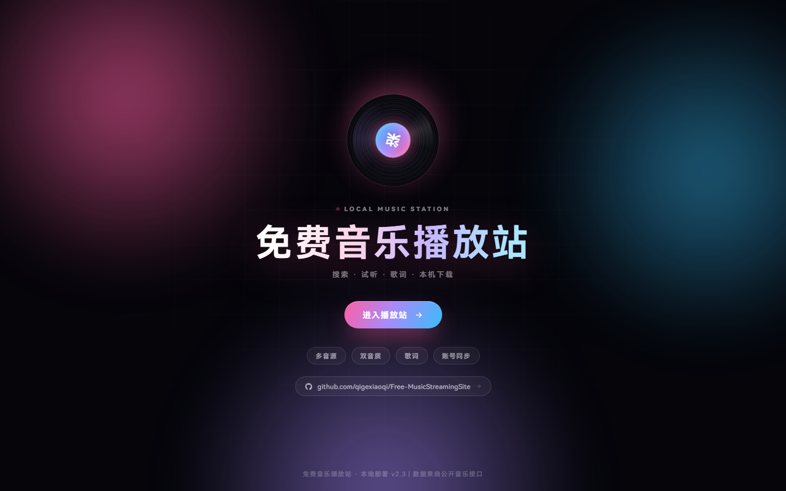
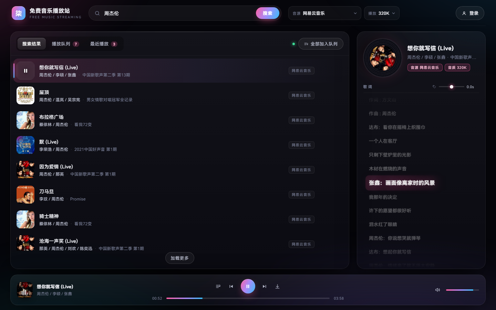
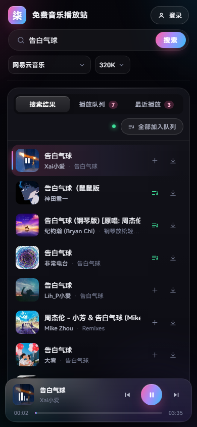
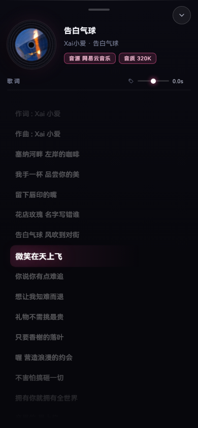
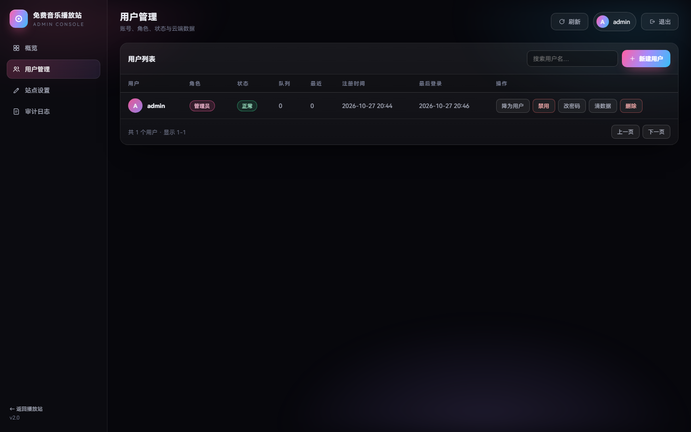
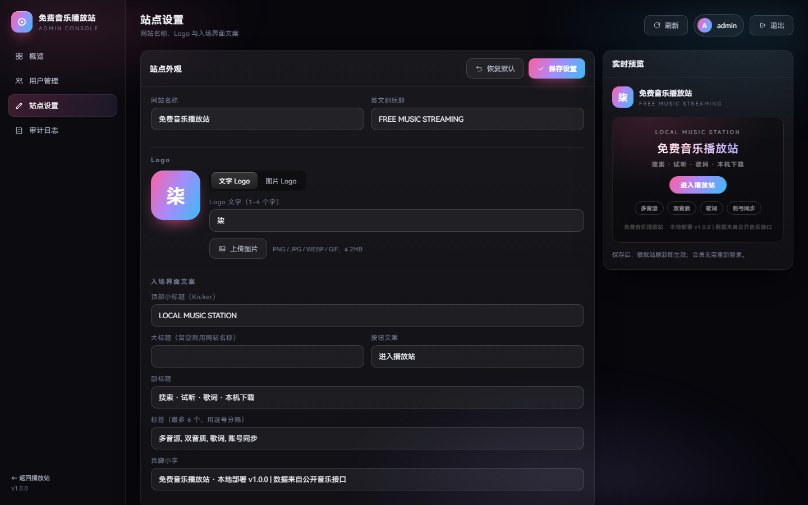
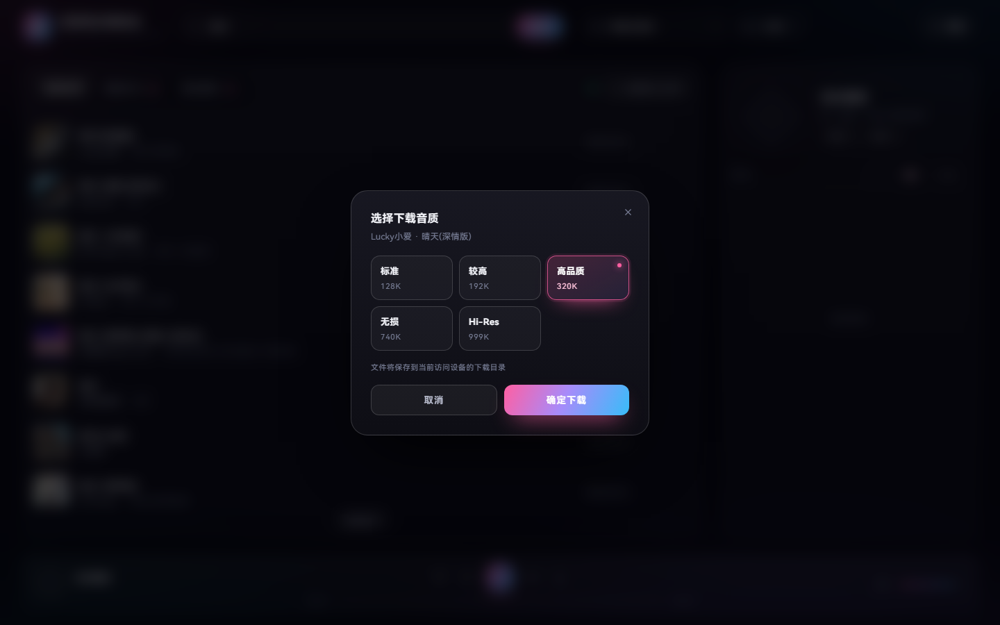

<div align="center">


# FreeMusicStreamingSite · 免费音乐播放站

**一个跑在自己电脑上的在线音乐播放站。**
搜索 · 试听 · 滚动歌词 · 本机下载 · 账号同步 · 管理后台

[](https://www.python.org/)
[]()
[](docker-compose.yml)
[]()
[]()
[](LICENSE)

[快速开始](#-快速开始) · [Docker 部署](#-docker-部署推荐给-nas--服务器) · [功能一览](#-功能一览) · [管理后台](#-管理后台) · [常见问题](#-常见问题)

</div>

---

## 📸 预览

<div align="center">


**入场界面** · 黑胶唱片 + 极光玻璃拟态 + GitHub 入口



**播放界面** · 搜索结果 / 播放队列 / 最近播放 · 右侧滚动歌词 · 底部播放器
</div>

---

## ✨ 功能一览

<table>
<tr><td width="50%" valign="top">

**🎵 播放**
- 多音源切换（网易云 / JOOX / QQ / 酷狗…，进页面实测可用性）
- 播放音质独立选择：128 / 192 / 320 / 740 / 999K
- 播放失败自动走本地中转，仍不行则自动降档重试
- 顺序 / 单曲 / 随机，进度拖动、音量记忆

**📝 歌词**
- LRC 逐行高亮居中滚动
- 有翻译时双语显示
- 点击任意一行跳转，`±0.1s` 偏移微调

**📥 下载**
- 点击下载先选音质，确定才开始，取消什么都不做
- 文件只落到**访问网页这台设备**的下载目录

</td><td width="50%" valign="top">

**🗂 列表**
- 播放队列**只能手动添加**（点 `＋` 或「全部加入队列」）
- 最近播放自动记录（去重 / 上限 100）
- 搜索结果悬停预览大封面

**👤 账号**
- 注册 / 登录，队列 + 最近播放 + 偏好同步到账号
- 未登录也能正常听歌，数据存本地
- 密码 PBKDF2-SHA256（12 万轮 + 随机盐）

**🛠 后台**
- 概览统计 / 用户管理 / 审计日志
- **站点设置**：站名、Logo、入场文案实时改

</td></tr>
</table>

---

## 🚀 快速开始

### Windows（推荐）

```text
1. 装 Python 3.8+        https://www.python.org/downloads/
   （安装时勾选 “Add Python to PATH”）
2. 双击 web.bat
3. 浏览器自动打开 http://127.0.0.1:7788
```

### macOS / Linux

```bash
python3 server.py
# 打开 http://127.0.0.1:7788
```

> **不用装任何依赖。** 服务端只用 Python 标准库，前端是原生 HTML / CSS / JS。
> 换端口：`web.bat 9000` 或 `python3 server.py 9000`（被占用会自动顺延）。

### 🐳 Docker 部署（推荐给 NAS / 服务器）

镜像基于 `python:3.12-slim`，只拷贝 `server.py` 与 `public/`，非 root 运行，自带健康检查。

```bash
git clone https://github.com/qigexiaoqi/FreeMusicStreamingSite.git
cd FreeMusicStreamingSite

# 构建 + 后台启动
docker compose up -d --build

# 首次启动日志里会打印 admin / admin
docker compose logs -f
```

访问 `http://<主机IP>:7788`，后台 `http://<主机IP>:7788/admin`
（容器内已监听 `0.0.0.0`，所以局域网内其它设备也能访问）。

不用 compose 也可以：

```bash
docker build -t freemusicstreamingsite:latest .

docker run -d --name freemusic \
  -p 7788:7788 \
  -v freemusic-data:/app/data \
  --restart unless-stopped \
  freemusicstreamingsite:latest
```

**数据持久化**：账号、站点配置、上传的 Logo、审计日志都在容器内 `/app/data`。
compose 默认挂了命名卷 `freemusic-data`；想直接看宿主机文件就改用：

```yaml
volumes:
  - ./data:/app/data     # Linux 上先执行：mkdir -p data && sudo chown 10001 data
```

**环境变量**

| 变量 | 默认值 | 说明 |
| --- | --- | --- |
| `XQ_HOST` | `127.0.0.1` | 监听地址；容器内固定 `0.0.0.0` |
| `XQ_PORT` | `7788` | 监听端口（命令行数字参数优先级更高） |
| `XQ_NO_BROWSER` | 空 | 设为 `1` 则不尝试拉起浏览器（容器内默认开启） |

**运维小抄**

```bash
docker compose ps                 # 状态 + 健康检查结果
docker compose restart            # 重启
docker compose down               # 停止（数据卷保留）
docker compose down -v            # 停止并删除数据卷（账号会一起清空）
docker compose pull && docker compose up -d   # 更新镜像后重启
```

### 默认管理员

首次启动自动创建：

| 用户名 | 密码 |
| --- | --- |
| `admin` | `admin` |

后台地址：`http://127.0.0.1:7788/admin`
👉 **第一件事请去后台把 admin 密码改掉。**

---

## 🖥 界面与交互

### 入场 → 主界面

- 全屏入场界面：旋转黑胶 + 极光 + 流光标题
- 点「进入播放站」进场；点左上角**品牌区**可随时回到入场界面，音乐不中断，按钮变成「继续听」
- 入场界面下方是 **GitHub 开源地址**

### 播放队列 · 最近播放

| 操作 | 结果 |
| --- | --- |
| 点搜索结果任意一行 | 立即播放，**不进队列** |
| 点行尾「＋」 | 加入播放队列 |
| 「全部加入队列」 | 当前列表整批入队，并从第一首开始播 |
| 队列页「×」/「清空」 | 移出单曲 / 清空队列 |
| 播放任意一首 | 自动写入最近播放 |

上一首 / 下一首在**你当前点击的那个列表**里走（搜索结果 / 队列 / 最近播放），不会串台。

### 手机端

<div align="center">


</div>

- ≤ 980px 自动切换：顶栏换行、搜索整行、播放条固定底部（避开 iPhone 安全区）
- 列表操作按钮常驻，不依赖 hover
- 点播放条左侧封面或歌名 → **全屏歌词抽屉**上滑，包含手势条与关闭按钮

---

## ⌨️ 快捷键

| 键 | 作用 |
| --- | --- |
| `空格` | 播放 / 暂停 |
| `←` `→` | 后退 / 前进 5 秒 |
| `Shift + ←` / `Shift + →` | 上一首 / 下一首 |
| `M` | 静音切换 |
| `Esc` | 关闭弹窗 / 收起手机歌词抽屉 |

## 🔗 URL 参数

| 参数 | 作用 |
| --- | --- |
| `?fast=1` | 跳过入场动画 |
| `?q=周杰伦` | 打开即搜索 |
| `?auto=1` | 自动播放第一条结果（配合 `q`） |

示例：`http://127.0.0.1:7788/?fast=1&q=晴天&auto=1`

---

## 🛠 管理后台

<div align="center">


**用户管理** · 角色 / 状态 / 云端数据 / 分页搜索
</div>

| 模块 | 能力 |
| --- | --- |
| **概览** | 用户数、管理员数、7 天活跃、禁用数、队列/最近播放总量、运行时长、最近操作 |
| **用户管理** | 搜索分页；设为管理员 / 降级、禁用 / 恢复、重置密码、清空该账号云端数据、删除账号 |
| **站点设置** | 网站名称、英文副标题、Logo、入场界面全部文案，带实时预览，一键恢复默认 |
| **审计日志** | 登录、注册、后台增删改全部留痕（内存 500 条 + `data/audit.log`） |

**安全约束**：普通用户访问后台接口 403；管理员不能降级 / 禁用 / 删除自己；系统至少保留一个管理员；登录失败 5 分钟内超过 10 次会被限流。

### 站点设置（改站名 / Logo / 入场文案）

<div align="center">

</div>

| 字段 | 作用 |
| --- | --- |
| 网站名称 | 顶栏标题、入场大标题（未单独填写时）、浏览器标签页 |
| 英文副标题 | 顶栏品牌下方那行小字 |
| **Logo** | 文字（1-4 字）或上传图片（PNG / JPG / WEBP / GIF ≤ 2MB）；同步用于顶栏、唱片中心、登录弹窗 |
| 顶部小标题 | 入场界面上方那行字距很宽的英文 |
| 大标题 | 入场主标题，留空则跟随网站名称 |
| 按钮文案 | 入场按钮文字（播放中会自动变成「继续听」） |
| 副标题 / 标签 / 页脚 | 入场界面其余文案 |

改完点「保存设置」，播放站刷新即生效；不用重启服务、不用重新登录。

---

## 📥 下载说明

<div align="center">

</div>

点行尾「↓」或播放条的下载键 → 弹出音质选择（128 / 192 / 320 / 740 / 999K）→ 点「确定下载」才开始解析下载。

- 点「取消」、点遮罩或按 `Esc` 只会关掉弹窗，**不产生任何下载**
- 下载音质与在线播放音质完全独立
- 文件通过浏览器本地保存到**访问网页这台设备**的下载目录，服务器不留副本

---

## 📁 目录结构

```
FreeMusicStreamingSite/
├─ web.bat              一键启动（Windows，纯 ASCII）
├─ server.py            本地服务：静态 + 音乐反代 + 音频中转 + 下载中转
│                       + 账号 + 云端同步 + 后台 API + 站点配置
├─ Dockerfile           容器镜像（python:3.12-slim，非 root，自带健康检查）
├─ docker-compose.yml   一键编排：端口 7788 + 数据卷 freemusic-data
├─ .dockerignore        构建上下文瘦身
├─ public/
│  ├─ index.html        播放站结构
│  ├─ style.css         全部样式（极光 / 玻璃 / 黑胶 / 歌词 / 手机抽屉）
│  ├─ app.js            全部逻辑（搜索 / 队列 / 最近 / 歌词 / 下载 / 登录 / 外观）
│  └─ admin.html        管理后台（单文件：概览 / 用户 / 站点设置 / 审计）
├─ data/                运行后自动生成（不入库 / 不进镜像）
│  ├─ users.json        账号与云端数据
│  ├─ site.json         站点外观配置
│  ├─ uploads/          后台上传的 Logo
│  ├─ secret.key        登录 cookie 签名密钥
│  └─ audit.log         审计日志
└─ docs/                截图与 Banner
```

---

## 🔌 接口

### 自有接口

| 路由 | 说明 |
| --- | --- |
| `GET /api?types=...` | 反代音乐接口（搜索 5 分钟、歌词/封面 1 天、播放地址 4 分钟缓存） |
| `GET /stream?url=` | 音频流中转，透传 `Range`（可拖进度） |
| `GET /dl?url=&name=` | 下载中转，`Content-Disposition` + UTF-8 文件名 |
| `GET /img?url=` | 封面中转（防盗链兜底） |
| `GET /site` | 站点外观配置（公开） |
| `GET /uploads/<file>` | 后台上传的图片 |
| `POST /auth/register` `POST /auth/login` `POST /auth/logout` `GET /auth/me` | 账号 |
| `GET/PUT /sync` | 播放队列 + 最近播放 + 偏好 |
| `GET/POST /admin/api/site` · `POST site/logo` · `POST site/reset` | 站点设置（需管理员） |
| `GET /admin/api/stats` · `users` · `audit` · `POST users` · `users/update` · `users/delete` | 后台（需管理员） |

### 音乐上游

上游：`https://music-api.gdstudio.xyz/api.php`

```
搜索  ?types=search&source=netease&name=关键词&count=30&pages=1
播放  ?types=url&source=netease&id=<url_id>&br=320
歌词  ?types=lyric&source=netease&id=<lyric_id>       → { lyric, tlyric }
封面  ?types=pic&source=netease&id=<pic_id>&size=300  → { url }   ← 两步：先拿地址再当图用
```

`br` 支持 128 / 192 / 320 / 740 / 999，实际以返回的 `br` 为准（网易云 999 通常回 948 无损）。

---

## ❓ 常见问题

<details>
<summary><b>某个音源是灰的 / 标了「仅搜索」？</b></summary>

上游对不同音源的开放程度不一样。进入页面会实测「能不能搜到 + 能不能拿到播放地址」，拿不到的禁用并标注，避免点了放不出来。
</details>

<details>
<summary><b>提示「该曲目暂无可用播放地址」？</b></summary>

多见于版权受限或冷门翻唱。换个版本、换个音源，或降一档音质再试。
</details>

<details>
<summary><b>下载的文件在哪？</b></summary>

在**访问网页这台设备**的浏览器下载目录（一般是「下载 / Downloads」），服务器端不留副本。
</details>

<details>
<summary><b>忘记管理员密码？</b></summary>

停掉服务，删除 `data/users.json`（会连带清空所有账号数据），重启后重新生成 `admin / admin`。
</details>

<details>
<summary><b>端口被占用？</b></summary>

`web.bat` 会自动往后找可用端口，控制台会打印真实地址；也可以手动指定 `web.bat 9000`。
</details>

<details>
<summary><b>能部署到公网吗？</b></summary>

可以。最省事的方式是 Docker：

```bash
docker compose up -d --build
```

容器内已经监听 `0.0.0.0`，宿主机 `-p 7788:7788` 之后局域网即可访问。
公网暴露前请至少做三件事：**改掉 admin 密码**、在反向代理（Nginx / Caddy / Traefik）上加 HTTPS、加一层访问控制或限流。

本地直跑时默认只监听 `127.0.0.1`，仅本机可访问；想局域网访问用 `XQ_HOST=0.0.0.0 python server.py`。
</details>

<details>
<summary><b>容器起来了但数据没了 / 权限报错？</b></summary>

所有数据都在容器内 `/app/data`，**必须挂卷**才会持久化。
compose 默认用命名卷 `freemusic-data`；改用 `./data:/app/data` 绑定时，Linux 上要先 `mkdir -p data && sudo chown 10001 data`（镜像内以 uid 10001 的非 root 用户运行）。
</details>

---

## 🧱 技术栈

- **后端**：Python 3 标准库（`http.server` / `urllib` / `hashlib` / `hmac` / `json`），零第三方依赖
- **前端**：原生 HTML + CSS + JavaScript（无框架、无构建）
- **存储**：JSON 文件（`data/`），原子写入
- **鉴权**：PBKDF2-SHA256 口令哈希 + HMAC 签名 HttpOnly Cookie（30 天）
- **部署**：Windows 双击 `web.bat` / 任意平台 `python3 server.py` / `docker compose up -d`（镜像 `python:3.12-slim`，非 root + healthcheck）

---

## 📄 License

[MIT](LICENSE)

> 本项目仅供个人学习与自用。音乐版权归各平台与权利人所有，接口内容来自公开服务，请勿用于商业分发。
